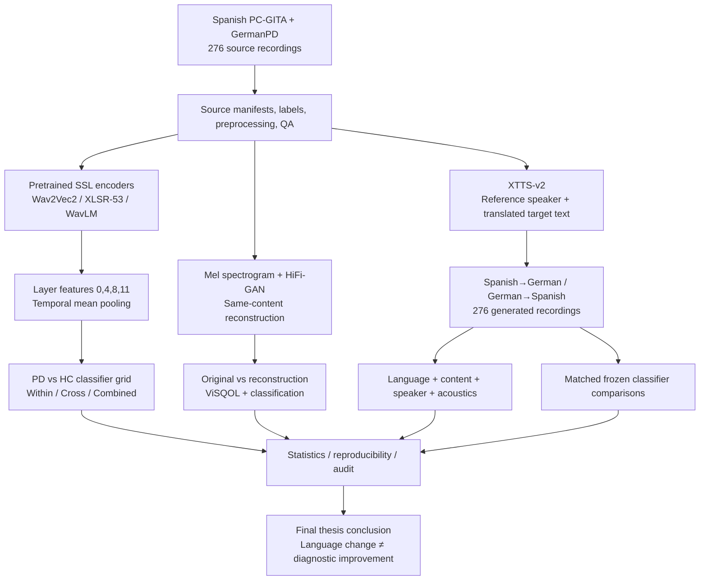

<div align="center">

# Prosenjit Chowdhury

### Artificial Intelligence · Data & Business Analytics · Enterprise Process Automation

**M.Sc. Artificial Intelligence Candidate | Friedrich-Alexander-Universität Erlangen-Nürnberg (FAU), Germany**  
**SAP SE — Experience across ERP Product Content, Industry Solutions, and SAP LeanIX / SAP Signavio**

[**GitHub**](https://github.com/prosenjit-chd) · [**Research project**](#featured-research-project--masters-thesis) · [**SAP experience**](#enterprise-experience--sap-se) · [**Technical skills**](#technical-toolkit) · [**Project architecture**](#research-system-architecture)

</div>

---

> **Professional focus:** I combine hands-on AI research with enterprise experience in data quality, workflow automation, content operations, performance analysis, and business-process improvement. At SAP SE, I have worked with three distinct teams spanning ERP content quality, industry go-to-market operations, and SAP LeanIX / SAP Signavio content marketing. At FAU's Pattern Recognition Lab, I designed and evaluated a multilingual speech-AI research workflow for Parkinson's disease (PD) classification.
>
> **Career interests:** Data Analyst · Business Analyst · AI / Machine Learning Engineer · Analytics & Automation · Business Technology Management · Digital Transformation.

**Status (November 2026):** Master's thesis research, experiments, manuscript, and physical-copy submission **completed**; final academic defense **pending**. My SAP employment is professional experience **separate from** the university research project. All figures below are research measurements or descriptions of work performed—not claims of production deployment or clinical readiness.

## At a glance

| Dimension | Evidence from my work |
|---|---|
| **Enterprise experience** | Three SAP SE functions since August 2024: ERP PCX / Central Content Services; industry content coordination; SAP LeanIX & SAP Signavio content marketing |
| **Enterprise data quality** | Standardized a **650+ record** web-content master inventory; checked metadata, language variants, links, publication status, and content ownership |
| **Digital content governance** | Built an expiry/action tracker, supported multilingual Digital Library asset workflows, and reviewed outdated or broken digital-asset links |
| **Analytics & reporting** | Supported monthly digital-content reports with Excel pivots, download filtering, Adobe Analytics/HubSpot-related source data, and cross-team validation |
| **Research data** | **276** clinical read-text recordings: 100 Spanish and 176 German; **138 PD / 138 healthy controls** |
| **ML experimentation** | **3** pretrained speech encoders × **4** selected representation layers × **6** classifier families in the expanded evaluation |
| **Speech generation** | **276/276** XTTS-v2 target-language audio files generated; **275/276 (99.64%)** recognized as intended language |
| **Scientific conclusion** | Reliable language generation **did not establish a robust, statistically significant improvement** in cross-language PD classification |

> **Confidentiality note:** SAP examples are summarized at the process/workstream level. Internal customer details, unpublished performance figures, company files, links, and identifiable clinical audio are intentionally omitted.

---

# Enterprise Experience — SAP SE

My SAP experience combines **enterprise information quality**, **business process coordination**, **analytics**, and **technical workflow improvement**. The work below represents three roles, not one continuous assignment to a single team.

## 1. Content Marketing — SAP LeanIX & SAP Signavio

**SAP SE · Working Student · April 2026–present**  
*Business Transformation Management / Content Marketing*

**Scope:** Digital content operations for enterprise architecture and business process transformation solutions, supporting global stakeholders and localized assets.

### Enterprise data and digital-content governance

- **Website content master data:** Built and standardized an Excel-based inventory covering **650+ signavio.com records**, with fields such as content title, language/locale, campaign or classification codes, submission type, publication status, and live URL. Identified entries requiring manual Digital Asset Management (DAM) verification rather than assuming every link was valid.
- **DAM link quality:** Reviewed expired or inaccessible asset links, flagged records for retirement or replacement, and coordinated corrections so website and library references could be reconciled.
- **Digital Library operations:** Supported uploads, folder placement, metadata QA, lifecycle tracking, title/description checks, document localization, and consistency against English master assets.
- **Multilingual publishing:** Coordinated localized content for **German, French, Spanish, Portuguese, Japanese, and Korean** workflows as applicable; validated locale values, taxonomy, descriptions, and asset associations. Completed a documented group of **10 localized assets** and later checked Korean SAP Signavio whitepaper metadata against source-master fields.
- **Expiry and ownership tracking:** Created a structured content-expiry tracker through the end of 2026, organizing records by expiry month, owner, required action, and completion status to make follow-up more systematic.
- **Customer-reference evidence review:** Worked on structured reference prioritization covering solution labels, use cases, available SAP LeanIX/SAP Signavio/SAP.com links, link quality, and evidence for web suitability. Kept unverified fields explicit rather than inventing customer claims.

**Business relevance:** Content discoverability, version control, lifecycle risk reduction, cleaner reporting inputs, more reliable localization, and transparent stakeholder follow-up.

### Digital analytics and performance reporting

- Contributed to monthly **SAP LeanIX and SAP Signavio content-performance reporting**, interpreting download tables, digital engagement measures, and campaign-related insights with report owners.
- Used **Excel pivot-based download views** and content-type filters to distinguish downloadable assets from registrations, demos, and other conversion events before building ranked asset lists.
- Supported reporting workflows associated with **Adobe Analytics and HubSpot**, coordinating source access, manual checks, and review by more experienced tool owners where necessary.
- Maintained a **SharePoint site-usage tracker** for marketing-content activity and investigated workbook consistency when monthly input rows and calculated fields did not update as expected.
- Supported paid-media and nurture insights by reconciling stakeholder input, asset performance changes, and rebranding requirements for recurring management presentations.

**Analytical methods:** Data cleaning · classification/filter logic · pivot analysis · KPI interpretation · QA of source-to-slide numbers · issue escalation · reporting documentation.

### Content operations, campaign enablement, and collaboration

- Prepared and coordinated social/campaign copy for enterprise events and campaigns, including **SAP TechEd** and **SAP Transformation Excellence Summit (STES)** activities.
- Maintained a recurring **LinkedIn monitoring and response-suggestion tracker** for SAP LeanIX and SAP Signavio, providing structured observations rather than untracked ad hoc notes.
- Supported global publication workflows and localized hero/content assets; reviewed titles, product terminology, metadata, URLs, and publication readiness.
- Contributed to **email best-practice and AI-in-content-marketing enablement** discussions, focusing on workflow scenarios, governance, and practical opportunities for more consistent content operations.
- Coordinated through **Microsoft Teams, SharePoint, Excel, Jira**, and cross-functional stakeholder reviews. Troubleshot access/process blockers and documented the status of work in progress.

**Important distinction:** AI marketing automation and RAG-related ideas were **exploration/enablement topics**; this README does not claim an unverified deployed enterprise AI system or realized cost savings.

### Selected work-to-skill mapping

| Workstream | My contribution | Transferable job skill |
|---|---|---|
| Website metadata inventory | Standardized 650+ content records and review fields | Data quality, information architecture, structured Excel analysis |
| Library lifecycle management | Expiry/action tracker and metadata validation | Governance, process controls, auditability |
| Localization operations | Multi-language asset and taxonomy checks | Cross-market operations, QA, stakeholder coordination |
| Digital reports | Pivot/filter logic and slide reconciliation | Analytics, KPI interpretation, business communication |
| Customer references | Evidence-based solution/use-case/link review | Requirements analysis, data validation, research |
| Campaign & social support | Structured tracking and content coordination | Project operations, reporting, cross-functional delivery |

## 2. Industry Content Coordination — Professional Services & EC&O

**SAP SE · Working Student · August 2025–March 2026**  
*Professional Services and Engineering, Construction & Operations (EC&O)*

- Supported **industry go-to-market and business-update workflows**, translating inputs from technical and commercial stakeholders into structured, readable material.
- Coordinated **customer win stories, go-live narratives, customer references, and partner/industry content** for internal review and publication readiness.
- Prepared **research briefs, interview questions, and stakeholder follow-ups** to help gather accurate customer/project evidence.
- Maintained structured customer and industry-reference information, including sub-industry categorization, status tracking, content readiness, and documentation quality.
- Collaborated with regional and cross-functional contacts to reconcile business details, approvals, and messaging.

**Capabilities built:** Requirements gathering · stakeholder interviews · business research · structured documentation · go-to-market operations · evidence validation · executive-ready communication.

## 3. ERP Product Content Excellence — Central Content Services

**SAP SE · Working Student · August 2024–July 2025**  
*ERP Product Content Excellence (PCX) / Central Content Services*

- Supported **SAP S/4HANA-related product-content and scope-item metadata quality** work, including field validation, consistency checks, release-related review, and issue tracking. This describes content/process work; it does **not** imply administration of SAP S/4HANA Cloud as an end-user system.
- Worked with structured information across **Jira and internal content/release systems**, reconciling identifiers, mapping sheets, metadata fields, and documentation.
- Used **Excel, VBA/macros, and Microsoft Power Automate** for repeatable checking, spreadsheet operations, and process-support workflows.
- Supported QA documentation and coordination across colleagues in **Germany, India, and China**, with an emphasis on traceable decisions and consistent source information.

**Capabilities built:** Data validation · metadata reconciliation · process mapping · workflow automation · quality assurance · documentation · international collaboration.

### SAP experience: the common technical thread


Across all three roles, I have worked at the intersection of **data quality, stakeholder requirements, business processes, and clear evidence-based outputs**. That experience is directly applicable to business analysis, data operations, enterprise architecture support, process improvement, and analytics roles.

---

# Featured Research Project — Master's Thesis

## Voice Conversion for Crosslingual Detection of Parkinson's Disease Using Speech Signals

**Institution:** Friedrich-Alexander-Universität Erlangen-Nürnberg (FAU), Germany  
**Lab:** Pattern Recognition Lab (Lehrstuhl für Mustererkennung / Informatik 5)  
**Program:** M.Sc. Artificial Intelligence  
**Supervisor:** Dr.-Ing. Tomás Arias-Vergara  
**Advisor:** Prof. Dr.-Ing. habil. Andreas Maier  
**Research period:** 2026 · **Manuscript submitted:** November 2026 · **Defense:** Pending

**Research question:** Can generating a speaker's speech in another language reduce Spanish–German domain mismatch for Parkinson's disease classification **without erasing information useful for distinguishing PD from healthy controls (HC)**?

### Why this problem matters

Speech recordings contain information about pronunciation, voice quality, articulation, rhythm, and pauses. These properties can differ with PD, but they also depend on **language, recording environment, source corpus, and speaker**. A classifier may achieve good within-corpus performance yet transfer poorly to recordings from another language/corpus.

This project connects four technical areas:

1. **Representation learning:** extracting acoustic embeddings from pretrained self-supervised speech models.
2. **Cross-domain evaluation:** testing Spanish-trained models on German speech and vice versa.
3. **Neural audio generation:** same-content waveform reconstruction and speaker-conditioned multilingual synthesis.
4. **Clinical-signal preservation:** testing whether language generation retains pathology-related acoustic contrasts and helps downstream PD/HC discrimination.

> **Central result:** The synthesis system usually generated the intended target language, and measurable speaker characteristics remained. However, pathology-related acoustic differences were only partly retained, and **cross-language PD classification did not show a reliable statistically significant overall improvement**. The negative result is a substantive research contribution: linguistic success is not the same as clinical utility.

## Research snapshot

| Research element | Final documented setting |
|---|---|
| Clinical corpora | Spanish **PC-GITA** and German **GermanPD** (Skodda-associated recordings) |
| Speech task | Read text only; source passages and recording conditions differ |
| Original samples | **276 files**: Spanish 100 (50 PD / 50 HC), German 176 (88 PD / 88 HC) |
| SSL checkpoints | `facebook/wav2vec2-base`, `facebook/wav2vec2-large-xlsr-53`, `microsoft/wavlm-base-plus` |
| Representation indices | **0, 4, 8, 11**; temporal mean pooling |
| Expanded classifier families | Linear SVM, RBF SVM, Logistic Regression, Random Forest, XGBoost, MLP |
| Main classification metric | **Unweighted Average Recall (UAR)**, with PD and HC recall |
| Reconstruction | HiFi-GAN, original → mel spectrogram → reconstructed waveform |
| Multilingual synthesis | **XTTS-v2** conditioned on a source-speaker audio excerpt and fixed target-language text |
| Generation directions | 100 Spanish-source → German; 176 German-source → Spanish |
| Evaluation | Language ID, Whisper ASR/WER/CER/WIP, ECAPA speaker similarity, ViSQOL, MOSNet, acoustic comparisons, matched PD classifiers, paired tests, FDR |
| Provenance and controls | Source-to-output linkage, frozen synthesis settings, development-excluded re-analysis, reproducibility/audit reports |

**Scope boundary:** 276 original recordings can yield **276 HiFi-GAN reconstructions** and **276 XTTS-v2 recordings** (828 audio instances across three conditions). These are **not 828 independent people or new clinical samples**.

## Research system architecture



### A. Data engineering and signal preparation

- Constructed traceable manifests tying every derived file to its original corpus, class label, and source identifier.
- Separated **published source acquisition conditions** from files prepared for model input. Main analysis used 16 kHz model-ready audio where required; HiFi-GAN and XTTS-v2 produced 22.05 kHz and 24 kHz files respectively before task-specific resampling.
- Investigated recording duration, class balance, audio properties, waveform/spectrogram structure, and corpus differences.
- Kept different source reading passages and acquisition conditions visible as possible confounders; did not attribute every cross-corpus difference purely to language.
- Preserved raw clinical audio privately and restricted public material to non-sensitive aggregate research outputs.

### B. Original-speech classification baseline

**Feature path:** `audio → SSL encoder → selected layer → temporal mean pooling → train-only scaling → classifier → UAR / recalls`.

Scenarios: **ES→ES**, **DE→DE**, **ES→DE**, **DE→ES**, and **combined-language**. For classification notation, the arrow means **training corpus → test corpus**; this differs from the arrow used for language generation.

**Preliminary baseline** (earlier two-classifier protocol):

| Measure | Preliminary UAR |
|---|---:|
| Mean within-language | **0.7666** |
| Mean cross-language | **0.6021** |
| Gap | **0.1645** |

**Final expanded original-speech evaluation** (scenario-best *observed* configurations):

| Train → test | SSL model / layer | Classifier | Observed UAR |
|---|---|---|---:|
| Spanish → Spanish | Wav2Vec2 / 4 | Linear SVM | **0.8500** |
| German → German | XLSR-53 / 4 | Random Forest | **0.7898** |
| Spanish → German | WavLM / 11 | Logistic Regression | **0.7273** |
| German → Spanish | Wav2Vec2 / 0 | MLP | **0.7400** |
| Spanish + German → Combined | XLSR-53 / 11 | XGBoost | **0.8080** |

These values are **descriptive best-of-grid results** among tested configurations, not selection-independent generalization estimates. The preliminary and expanded evaluations used different procedures and must **not** be compared as if they were identical matched protocols.

### C. HiFi-GAN: controlled, same-content reconstruction

**Goal:** Is generating a new waveform from a mel spectrogram already enough to change the measured PD/HC classification behavior?

```text
Original speech → mel-spectrogram → HiFi-GAN vocoder → reconstructed speech
               (same intended words and language)
```

| Metric | Recorded result |
|---|---:|
| Reconstructed files | **276/276** |
| Original mean UAR (120 comparison rows) | **0.7016** |
| Reconstructed mean UAR | **0.7046** |
| Mean signed UAR change | **+0.0030** |
| Mean absolute UAR change | **0.0264** |
| Mean same-content ViSQOL MOS-LQO | **4.2551** |

**Interpretation:** Same-content resynthesis produced a small aggregate difference in downstream classification, but that alone does **not prove preservation of each PD-related signal characteristic**. ViSQOL is meaningful here because reference and generated audio are intended to contain the same words.

### D. Research iteration: from acoustic-domain prototype to true target-language synthesis

An earlier **embedding-conditioned acoustic-domain prototype** attempted to shift signal characteristics toward another corpus, but **did not change the spoken words**. It is retained as an informative historical experiment—not represented as genuine spoken-language translation.

The final method uses **speaker-conditioned multilingual text-to-speech synthesis**, not direct source-waveform translation:

```text
Original Spanish or German speaker recording
  ├── Reference voice excerpt: Spanish source ~15 s / German source ~10 s
  └── Fixed translated target-language reading passage
                      ↓
                   XTTS-v2
                      ↓
        New speech in the opposite language
```

The final synthesis was developed through a **12-file pilot**, controlled refinement, an **80-recording validation subset**, and the **full 276-file evaluation**. Frozen settings documented for the final run include `temperature=0.65`, `repetition_penalty=3.50`, `top_p=0.85`, and `speed=1.00`. German output used four text chunks; Spanish output used five target sentences.

**Critical distinction:** The final thesis notes that the exact selection rule for the earlier 80-recording subset cannot be fully reconstructed from retained summaries. It should **not** be advertised as independent external clinical validation.

### E. Generation quality: did the language change work?

| Metric | Spanish → German | German → Spanish | Overall |
|---|---:|---:|---:|
| Generated output files | 100/100 | 176/176 | **276/276** |
| Intended-language identification | 100/100 | 175/176 | **275/276 (99.64%)** |
| Mean ASR-based WER | 0.8065 | 0.4430 | **0.5747** |
| Mean ASR-based CER | 0.6512 | 0.4103 | **0.4976** |
| Mean ASR-based WIP | 0.3692 | 0.5248 | **0.4685** |

**Implementation:** A Whisper-base checkpoint supported automatic language identification and ASR text comparison. The **WER/CER/WIP results are model-mediated proxies**, not verified human transcription quality; the Spanish and German directions differ in target text, reference duration, and source corpus.

### F. Speaker characteristics: ECAPA-TDNN comparison

The evaluation compared **matched original/generated speaker embeddings** with **different-speaker controls**, using the appropriate 16 kHz input preparation.

| XTTS direction | Matched cosine | Different-speaker control | Difference |
|---|---:|---:|---:|
| Spanish → German | **0.6162** | 0.1170 | **+0.4992** |
| German → Spanish | **0.5297** | 0.0695 | **+0.4602** |

Matched original/generated voices were more similar than different-speaker controls. This supports retention of **some speaker-specific characteristics**—not proof of perfect voice identity or pathology preservation.

### G. Pathology-related acoustic information

- **13/22 (59.1%)** pooled PD–HC acoustic feature contrasts retained their original direction in the generated condition; preservation was **incomplete**.
- In the reported standardized acoustic feature space, mean PD-to-HC-centroid distance changed from **4.3870** (original) to **3.8429** (generated), with recorded `p < 0.0001`.
- This indicates **movement toward the HC centroid under that measurement**, **not proof of PD-specific normalization**: a corresponding generated-HC movement control was not established, and synthesis can change the entire feature distribution.

### H. Does generation actually improve PD classification?

To isolate generation effects, fixed classifiers were compared on the **same source cases** before and after synthesis; the model, embedding layer, and classifier remained unchanged.

| Matched comparison | Original UAR | Generated UAR | ΔUAR | FDR-adjusted q |
|---|---:|---:|---:|---:|
| German-trained, Spanish-source; Wav2Vec2 L8 + MLP | 0.6900 | 0.7300 | **+0.0400** | **1.0000** |
| Spanish-trained, German-source; WavLM L11 + MLP | 0.6818 | 0.6761 | **−0.0057** | **1.0000** |

These were **illustrative highlighted comparisons**, not preregistered primary selections; **neither improvement was statistically significant after FDR correction**.

The broader **144 matched configuration comparisons** provide essential context:

| Classifier training corpus | Improved | Decreased | Unchanged | Mean ΔUAR |
|---|---:|---:|---:|---:|
| German-trained (72 settings) | 13 | 46 | 13 | −0.0306 |
| Spanish-trained (72 settings) | 4 | 58 | 10 | −0.0447 |
| **Total** | **17** | **104** | **23** | — |

In the earlier 80-recording subset, a Spanish→German Logistic Regression result improved by **+0.1500 UAR**, with nominal `p=0.025` but FDR-adjusted `q=0.100`: **not significant after multiple-testing correction**. A separate analysis removed the 12 development recordings (**N=264**) and did not retain a robust positive cross-language classification effect.

**Final conclusion:** Correct target-language synthesis, some speaker preservation, and partial acoustic contrast preservation are **not sufficient** to demonstrate improved downstream clinical speech classification.

## Experimental safeguards and scientific limitations

| Topic | How it is handled |
|---|---|
| **Preliminary vs final baseline** | Different model-selection protocols; comparisons explicitly labelled descriptive |
| **Train/test leakage** | Train-only scaling recorded; full historical participant-level fold provenance not independently re-established |
| **Source identities** | Repeated identifier strings in the German manifest mean raw strings cannot automatically be treated as independent patient IDs |
| **Data confounding** | Spanish and German recordings come from different corpora, speakers, texts, and recording environments |
| **Generated clinical labels** | Synthesized audio inherits the source reference label; it does not create a diagnosis or new participant |
| **ASR evaluation** | Whisper-base may contribute to WER; content scores are not human intelligibility ratings |
| **Selection bias** | Scenario maxima and selected classifiers are not unbiased expected clinical performance |
| **Statistics** | Nominal `p < 0.05` is not called a discovery if FDR-adjusted `q ≥ 0.05` |
| **Generative effects** | Acoustic centroid movement and group-level feature contrasts do not prove patient-specific pathology preservation |
| **External validation** | No independent multicenter clinical performance guarantee is claimed |
| **Medical safety** | Research classifier only; **not** a clinical diagnostic device |

---

# Engineering Implementation & Repository Navigation

The following paths are documented in the original project README. They are **repository references**, not claims that private datasets, checkpoints, or every archived artifact are included in a public clone.

```text
.
├── README.md                              # This overview
├── outputs/                               # Original-speech baseline outputs (access-dependent)
├── voice_conversion/                      # HiFi-GAN and historical acoustic prototype
│   └── stage5_embedding_conditioned_vc/  # Earlier non-linguistic acoustic-domain experiment
└── true_cross_language_vc/
    ├── 17_reports/                        # 12-file initial synthesis pilot report
    ├── 19_pilot_refinement/               # Early refinement and QA
    ├── 20_spanish_to_german_final_refinement/
    ├── 21_validation_80/                  # Earlier validation subset and interpretation
    └── 22_full_276_evaluation/
        ├── 01_inventory/                  # Dataset / outputs inventory
        ├── 02_cohort_tags/                # Source/cohort linkage
        ├── 03_transcripts/                # Text references
        ├── 04_translation/                # Target-language text preparation
        ├── 07_audio_qc/                   # Audio technical checks
        ├── 08_language_id/                # Target-language identification
        ├── 09_content_accuracy/           # WER/CER/WIP
        ├── 10_speaker_preservation/       # ECAPA embeddings and controls
        ├── 11_pathology_features/         # Acoustic measurements
        ├── 12_pathology_preservation/     # PD–HC contrasts
        ├── 13_pd_classification/           # Matched classification results
        ├── 14_statistics/                  # Statistical analysis
        ├── 15_subgroup_analysis/           # Directional/subgroup checks
        ├── 16_figures/                     # Research figures
        ├── 17_tables/                      # Formal result tables
        ├── 18_listening_examples/          # Private / access-controlled examples
        ├── 19_reports/                     # Evaluation reports
        ├── 20_reproducibility/             # Environment/config/manifests
        ├── 21_final_scientific_audit/      # Corrected interpretation and final audit
        ├── logs/                           # Processing records
        └── scripts/                        # Main Python pipeline
```

### Full-cohort pipeline and script responsibilities

| Pipeline component | Script | Responsibility |
|---|---|---|
| Preflight | `00_preflight_and_inventory.py` | Input checks and inventory |
| Cohort provenance | `01_cohort_provenance_tagging.py` | Preserve cohort, source, and label traceability |
| Text/reference preparation | `02_prepare_texts_and_references.py` | Freeze target passages and speaker references |
| Multilingual synthesis | `03_synthesize_276.py` | Generate source-linked target-language files |
| Technical/speech QA | `04_audio_qc_lid_asr_spk_276.py` | Audio checks, language ID, ASR, speaker comparisons |
| Acoustic/pathology analysis | `05_pathology_and_normalization_276.py` | Acoustic features and centroid analyses |
| Classification/statistics | `06_pd_classification_and_statistics_276.py` | Matched PD/HC evaluation and tests |
| Error analysis | `07_subgroup_and_error_analyses_276.py` | Subgroup and direction review |
| Visualization/reproducibility | `08_figures_tables_listening_repro_276.py` | Figures, tables, approved examples, documentation |
| Reporting | `09_compile_full_276_report.py` | Consolidated evaluation report |
| Orchestration | `run_full_276_pipeline.py` | End-to-end execution driver |
| Final audit | `run_final_audit.py` | Post-run checks and reconciled scientific reporting |

**Code root:** `true_cross_language_vc/22_full_276_evaluation/scripts/`

### Reproducibility philosophy

1. **Separate development and evaluation:** Preserve the pilot iterations and frozen final synthesis configuration, and disclose overlaps when analyzing larger cohorts.
2. **Keep model-ready preprocessing explicit:** Document model inputs, audio rates, resampling, expected texts, and stage-specific conditions.
3. **Retain matched identifiers:** Compare original and generated measurements only when their source recording links are consistent.
4. **Audit metrics and aggregation:** Use pooled metrics when appropriate; do not average percentages across directions and present them as a pooled fraction.
5. **Preserve execution evidence:** Keep configurations, manifests, logs, tabular results, checksums, and correction notes.
6. **Distinguish exploratory and confirmatory claims:** Report non-significant adjusted tests honestly; do not overinterpret small positive examples.

**Before reproduction:** Data-access approval, the original clinical corpora, compatible pretrained model checkpoints, and the archived execution environment are required. **This README does not promise a one-command public reproduction** or include clinical data; inspect the archived environment and entry-point scripts before running them.

---

# Technical Toolkit

The list distinguishes **direct research work**, **hands-on SAP workflow tools**, and **additional analytics capabilities**. Tool names reflect project exposure, not certifications or production-system administration.

| Area | Tools / methods | Practical evidence |
|---|---|---|
| **Programming & data work** | Python, SQL, Excel, VBA | Research scripts; tabular preparation; SAP metadata and reporting tasks; automation-related work |
| **Deep learning / speech AI** | Wav2Vec2, XLSR-53, WavLM, HiFi-GAN, XTTS-v2 | Pretrained embeddings, vocoding, multilingual synthesis |
| **ML modelling** | SVM, Logistic Regression, Random Forest, XGBoost, MLP | Multi-model, multi-layer classification evaluation |
| **Audio & signal processing** | Waveforms, STFT, mel spectrograms, sampling/resampling, RMS, spectral features | Speech representation and quality analysis |
| **Speech evaluation** | Whisper ASR/LID, WER/CER/WIP, ECAPA-TDNN, ViSQOL, MOSNet | Language, content, speaker and quality checks |
| **Statistical evaluation** | UAR, sensitivity/specificity, cross-validation, McNemar, Wilcoxon, bootstrap, BH-FDR | Matched experiments, sensitivity checks, corrected interpretation |
| **Data/marketing analytics** | Excel PivotTables, Adobe Analytics-related reporting, HubSpot data, SharePoint usage | Download selection, web KPIs, monthly reporting support |
| **Enterprise processes** | SAP LeanIX / SAP Signavio content operations, Jira, SharePoint, Power Automate | Metadata QA, DAM governance, business workflow coordination |
| **Research delivery** | Git/GitHub, structured Python scripts, experiment logs, provenance, LaTeX | Reproducibility, documentation and final thesis |
| **Business collaboration** | Requirements and evidence gathering, stakeholder interviews, reporting, content QA | Three SAP teams and cross-regional coordination |

## Skills demonstrated through deliverables

**AI / ML Engineering:** Feature extraction · experiment design · model comparison · evaluation under domain shift · generative model assessment · validation and error analysis.

**Data / Business Analysis:** Data cleansing · metadata validation · KPI definition · pivot-based reporting · requirements traceability · evidence quality · stakeholder-ready interpretation.

**Process / Operations:** Lifecycle tracking · automation-support workflows · issue and owner tracking · documentation governance · publication QA · multi-market coordination.

**Responsible Engineering:** Restricted-data handling · reporting uncertainty · distinguishing correlation from causation · reproducibility and audit trails.

---

# Selected Portfolio Stories for Recruiters

These are concise examples of the value I can explain in an interview. The scale numbers below are deliberately limited to figures present in my documented work; no speculative cost savings or revenue impact are claimed.

| Business / research challenge | My approach | Verifiable outcome |
|---|---|---|
| **Inconsistent digital content metadata** | Built and standardized a structured web-content workbook; flagged links and localization fields for validation | **650+ records** organized for review and follow-up |
| **Content expiry and ownership visibility** | Created an owner/action/status-based inventory with month-wise tracking | Reusable expiry-management process through end of 2026 |
| **Multilingual publishing complexity** | Validated titles, locale fields, taxonomy, folder placement, and master-asset consistency | Documented workflows for **multiple languages**, including a **10-asset** localization task |
| **Ambiguous content-performance rankings** | Used defined pivot-data filters; excluded registration/demo activity from downloadable-asset reporting | More defensible monthly reporting inputs and review notes |
| **Cross-language ML generalization** | Tested pretrained SSL speech features across Spanish and German clinical corpora | Quantified baseline domain mismatch and identified limitations |
| **Can AI-generated speech retain useful medical signal?** | Reconstructed and synthesized paired speech; evaluated content, speakers, acoustics, and classifier effects | **276** source-linked multilingual outputs with audited research findings |
| **Risk of misleading positive ML results** | Compared matched settings; examined the larger grid and adjusted significance | Concluded **no robust cross-language diagnostic gain** despite successful synthesis |

### Resume-ready research description

> Developed an end-to-end Python-based speech-AI evaluation workflow for crosslingual Parkinson's disease classification using Spanish and German clinical speech. Compared Wav2Vec2/XLSR-53/WavLM representations and six classifier families; evaluated HiFi-GAN reconstruction and XTTS-v2 multilingual synthesis on 276 source recordings. Built traceable audio-quality, ASR, speaker-similarity, acoustic, statistical, and reproducibility analyses; found that high target-language generation accuracy (99.64%) did not translate into a reliable downstream classification benefit.

### Resume-ready SAP description

> Gained cross-functional SAP SE experience in ERP product-content QA, industry go-to-market coordination, and SAP LeanIX/SAP Signavio content marketing. Worked with metadata-validation and workflow-automation tools, standardized 650+ content records, supported multilingual Digital Library governance, maintained lifecycle and usage trackers, and contributed to data-driven content reporting and customer-reference analysis using Excel, SharePoint, Jira, and enterprise analytics inputs.

---

# Research Privacy, Corporate Confidentiality & Responsible Use

- **Clinical speech:** Do not publish raw patient recordings, derived identifiable speech, subject-level clinical metadata, restricted embeddings, or identifiable paths without the relevant data-use authorization.
- **SAP material:** Do not publish internal trackers, proprietary customer/reference details, non-public marketing measurements, internal links, employee information, or source documents. This README describes transferable responsibilities rather than reproducing corporate assets.
- **Figures and screenshots:** Reuse only if cleared under both the corresponding clinical dataset license and the applicable university/company policy.
- **Models:** Respect pretrained-model licenses and dataset restrictions; the presence of a model name does not grant a redistribution right.
- **Scientific integrity:** Research numbers are reported in context with their denominators, protocols, tests, and limitations. The software is **not a medical diagnosis tool**.
- **Academic status:** Thesis submitted does not mean the degree or final defense has been completed.

## Public vs restricted materials

| Suitable for a reviewed public repository | Keep in approved private storage |
|---|---|
| Sanitized research source code and configuration templates | Raw clinical recordings and any identifiable generated audio |
| Aggregate result tables with methodological context | Individual patient/speaker data and unrestricted embeddings |
| Approved scientific diagrams and write-ups | Corpus credentials and private/local paths |
| A generic summary of SAP responsibilities | SAP trackers, customer evidence, unpublished metrics, internal systems data |
| Reproducibility instructions without secrets | Restricted execution environments and access tokens |

---

# About Me & Opportunities

I am an **M.Sc. Artificial Intelligence candidate at FAU** with practical SAP SE experience across data, enterprise content systems, business operations, analytics support, and process improvement. My research strengthened my ability to move from an ambiguous technical question to structured datasets, experiments, trustworthy metrics, and an evidence-based conclusion. My SAP roles strengthened the complementary skills needed to make technical work usable in a real organization: **business understanding, stakeholder communication, information quality, and reliable delivery**.

I am especially interested in roles connecting these capabilities: **Data Analyst, Business Analyst, AI/ML Engineer, Process / Workflow Automation, Business Technology Management, and enterprise digital transformation**.

**GitHub:** [github.com/prosenjit-chd](https://github.com/prosenjit-chd)  
**University:** Friedrich-Alexander-Universität Erlangen-Nürnberg (FAU), Germany  
**Research lab:** Pattern Recognition Lab (PRL)

---

<sub>Last updated: November 2026. This README summarizes documented academic and professional experience. It is a public-facing portfolio description, not an official statement by SAP SE, FAU, or the clinical dataset providers.</sub>
