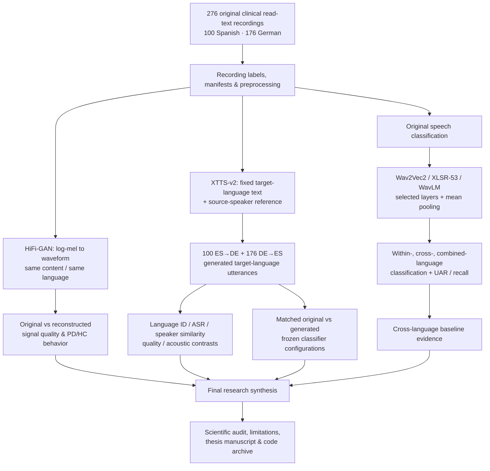

# Voice Conversion for Crosslingual Detection of Parkinson's Disease Using Speech Signals

**Master's Thesis Research | Pattern Recognition Lab | Friedrich-Alexander-Universität Erlangen–Nürnberg (FAU), Germany**

**Researcher:** Prosenjit Chowdhury  
**Degree:** M.Sc. Artificial Intelligence  
**Academic supervision:** Prof. Dr.-Ing. habil. Andreas Maier;  Dr.-Ing. Tomás Arias-Vergara 
**Research implementation:** Complete  
**Repository purpose:** Research code, technical methodology, experiment provenance, and reproducible *non-sensitive* documentation

> **Main scientific finding:** Generating Spanish speech in German and German speech in Spanish was technically feasible, but successful target-language generation did **not** produce a robust, statistically significant improvement in cross-language Parkinson's disease (PD) classification. Language transfer, speaker resemblance, preservation of disease-relevant acoustic information, and clinical classification performance are distinct outcomes.

This README documents the **completed thesis from research question to final evaluation**. All research-related sections come first. A completely separate [Personal & Professional Profile](#part-ii--personal--professional-profile) appears **after** the research documentation; my SAP experience is not part of the thesis experiments.

---

# PART I — COMPLETE MASTER'S THESIS RESEARCH

## 1. Research at a glance

| Item | Completed research |
|---|---|
| Research domain | Biomedical AI, speech signal processing, multilingual generative AI, domain shift |
| Core problem | Parkinson's disease vs. healthy-control classification across Spanish and German speech |
| Original recordings | **276** read-text recordings: **100 Spanish**, **176 German** |
| Clinical labels | **138 PD**, **138 healthy controls (HC)**; labels belong to original recordings |
| Original corpora | **PC-GITA** (Spanish) and **GermanPD / Skodda** (German) |
| Speech feature extractors | **Wav2Vec2**, **XLSR-53**, **WavLM** |
| Feature layers | Output indices **0, 4, 8, 11**; mean temporal pooling |
| Final classifier families | Linear SVM, RBF SVM, Logistic Regression, Random Forest, XGBoost, MLP |
| Same-content synthesis | **HiFi-GAN** reconstruction of 276 recordings |
| Cross-language synthesis | **XTTS-v2**; 100 Spanish→German and 176 German→Spanish generated recordings |
| Generated target-language identification | **275/276 (99.64%)** assigned to the intended language |
| Key statistical finding | No general PD classification improvement established after multiple-testing correction |
| Deliverables | Final thesis, automated experiment scripts, aggregate evaluations, plots, tables, audit and reproducibility reports |

**Research is completed.** This is a final project record, not an active to-do list or a proposed research plan. The presentation/defense process is academic administration and does not change the completed experimental status.

## 2. The research problem

Speech carries information beyond the words being spoken: voice quality, timing, rhythm, articulation, pitch, pauses, and speaker-specific acoustic traits. Some of these characteristics can be affected by PD. Automatic speech-based PD research aims to distinguish **PD** from **HC** speech using measured acoustic information rather than written transcripts alone.

The central engineering challenge is **cross-language and cross-corpus generalization**. A classifier trained and evaluated on one clinical speech corpus can perform worse on a corpus recorded in another language. This may occur because a learned representation captures language, text, recording conditions, speaker population, and disease-related information simultaneously. **Spanish vs. German** in this project also means **PC-GITA vs. GermanPD**; the design cannot isolate language as the sole cause of a performance gap.

The investigation addressed a concrete question:

> **Can speaker-conditioned generation of speech in another language reduce the mismatch encountered by a PD/HC classifier while retaining useful pathology-related speech information?**

The research tested this rather than assuming that synthetic multilingual speech automatically improves a medical classifier.

## 3. Research questions and answered outcomes

| Research question | Completed finding |
|---|---|
| RQ1 — How does Spanish/German mismatch affect classification? | The earlier baseline showed a meaningful within-language vs. cross-language UAR gap; the later expanded evaluation confirmed configuration- and direction-dependent differences. |
| RQ2 — Can speech be synthesized in the target language while retaining speaker/pathology-related traits? | **276/276** target-language outputs were generated; **275/276** were language-identified correctly. Speaker-related similarity exceeded mismatched-speaker controls, but preservation of acoustic PD–HC contrasts was incomplete. |
| RQ3 — Does the generated speech improve matched downstream PD/HC classification? | Isolated configurations improved, but effects were not statistically significant after FDR adjustment and improvements did not generalize reliably across the grid. |
| RQ4 — Are conclusions robust across classifiers, feature layers, and development-excluded data? | The 144-configuration comparison and 264-recording sensitivity analysis did not support a robust overall benefit. |

## 4. Research design and end-to-end architecture

The thesis deliberately separated **three processing branches**. A classifier baseline, a same-content neural reconstruction experiment, and a target-language synthesis experiment answer different questions and **must not be treated as interchangeable**.



**Terminology:** The registered title says *voice conversion*. The final XTTS-v2 system is more precisely **speaker-conditioned multilingual text-to-speech generation**: it synthesizes a **new utterance** from target-language text plus speaker-reference audio. It does **not** directly translate the source waveform sample by sample. The earlier embedding-conditioned acoustic-domain prototype did not change the actual words and is therefore a **historical exploratory branch**, not the main final target-language method.

## 5. Dataset, labels, and provenance

| Source corpus | Language | PD | HC | Original files |
|---|---|---:|---:|---:|
| PC-GITA | Spanish | 50 | 50 | 100 |
| GermanPD (Skodda) | German | 88 | 88 | 176 |
| **Total** | **2 languages** | **138** | **138** | **276** |

Both corpora were restricted to **read-text recordings**. That controls the *task category* but does **not** mean participants read the same words, used the same recording environment, or had identical demographics. Spanish and German source recordings also differed in average duration (approximately **18.12 s** vs **46.21 s** in the technical inventory).

Each original recording was linked to its source corpus, class, and corresponding generated outputs. The three completed audio conditions comprised:

| Audio condition | Files | What it represents |
|---|---:|---|
| Original | 276 | Clinical input read-speech recordings |
| HiFi-GAN reconstructed | 276 | Same-language, same-content neural waveform reconstruction |
| XTTS-v2 generated | 276 | New opposite-language utterances from speaker conditioning + fixed text |
| **Total audio instances** | **828** | **Three versions of 276 sources, not 828 unique patients or independent participants** |

**Data identity caution:** Some German identifier strings overlap across PD/HC label groups. The archived identifiers do not independently establish the number of unique participants or prove speaker-grouped fold construction. We do not equate file counts with verified subject counts, and we do not claim fully verified participant-level independence.

## 6. Preprocessing and audio representation

The processing branches used different model-ready audio formats. Original analysis inputs were prepared at **16 kHz** where required; the generated HiFi-GAN files were measured at **22.05 kHz**, and XTTS-v2 outputs at **24 kHz**. Evaluation tools such as ECAPA and Whisper were supplied their required sample rate (typically **16 kHz**) during analysis.

The signal-processing work included:

- Waveform loading, validation, mono conversion and task-specific resampling.
- Short-time Fourier transform (STFT), log-mel spectrograms and waveform inspection.
- Time/frequency comparisons, reconstructed-versus-original spectrograms, power spectral density and energy diagnostics.
- Source-to-output manifests, experiment file-count checks, technical audio-QC and non-silent-output checks.
- Explicit separation between original acquisition properties, generated-file properties, and temporary model-input transformations.

These representations support signal interpretation; a single waveform or spectrogram is **not** evidence of a clinical diagnosis.

## 7. Original-speech baseline: self-supervised learning + classifiers

### 7.1 Speech encoders

Three pretrained architectures were evaluated as fixed feature extractors:

| Model | Checkpoint recorded in the thesis | Contribution to comparison |
|---|---|---|
| Wav2Vec2 | `facebook/wav2vec2-base` | General self-supervised acoustic representations |
| XLSR-53 | `facebook/wav2vec2-large-xlsr-53` | Multilingual speech pretraining |
| WavLM | `microsoft/wavlm-base-plus` | Speech representations with denoising-oriented pretraining |

Output indices **0, 4, 8, and 11** were extracted and time-mean-pooled into fixed-dimensional representations. This is a **selected-layer** comparison: XLSR-53 has 24 Transformer blocks, whereas the selected Wav2Vec2 and WavLM checkpoints have 12, so index 11 is **not** the final XLSR-53 block.

### 7.2 Modeling and validation

The **preliminary** baseline compared Linear SVM and Logistic Regression. The **final expanded** evaluation covered **six classifier families**, four layer indices, and three encoders: **72 combinations per scenario**, with **504 saved scenario/condition results** across the seven recorded settings.

The thesis describes **five outer and five inner validation folds** for the final experiment, with class stratification and training-only standardization. The retained aggregate records do not fully establish participant grouping or identical fold provenance for every cross-language setting; this is a reproducibility limitation, not a claim of fully verified leakage-free evaluation.

The primary metric was **Unweighted Average Recall (UAR)**, defined as:

\[
\mathrm{UAR}=\frac{\mathrm{Recall}_{PD}+\mathrm{Recall}_{HC}}{2}
\]

PD recall and HC recall were considered separately to avoid hiding a clinically important sensitivity/specificity trade-off.

### 7.3 Preliminary baseline — historical intro-talk evaluation

| Training → testing | Best observed preliminary UAR |
|---|---:|
| Spanish → Spanish | 0.8400 |
| German → German | 0.8182 |
| Spanish → German | 0.7273 |
| German → Spanish | 0.6900 |
| Combined | 0.8080 |

**Across the preliminary configuration grid:** mean within-language UAR **0.7666**; mean cross-language UAR **0.6021**; gap **0.1645**. These historical figures motivated the multilingual synthesis work. They must **not** be presented as a matched-protocol comparison with the final expanded experiment.

### 7.4 Final expanded original-speech classification

| Scenario | Best observed configuration | UAR | PD recall | HC recall |
|---|---|---:|---:|---:|
| Spanish → Spanish | Wav2Vec2, layer 4, Linear SVM | **0.8500** | 0.8200 | 0.8800 |
| German → German | XLSR-53, layer 4, Random Forest | **0.7898** | 0.7955 | 0.7841 |
| Spanish → German | WavLM, layer 11, Logistic Regression | **0.7273** | 0.8295 | 0.6250 |
| German → Spanish | Wav2Vec2, layer 0, MLP | **0.7400** | 0.6600 | 0.8200 |
| Combined | XLSR-53, layer 11, XGBoost | **0.8080** | 0.7826 | 0.8333 |

These are **descriptive maxima over tested configurations**, not independent expected-performance estimates or confidence bounds. No one encoder consistently led across every scenario. PCA and t-SNE showed distinct original-corpus/language clusters; these are visualizations of representation structure, **not** calibrated measurements of the causal effect of language.

## 8. HiFi-GAN same-content reconstruction

This controlled branch tested **neural waveform reconstruction without deliberately changing spoken words or language**:

```text
Original speech → mel-spectrogram → HiFi-GAN vocoder → reconstructed waveform
        │                                                    │
        └────────── same-content comparison ─────────────────┘
```

All **276** input recordings were reconstructed. The saved UAR comparison covered **120 configuration-result rows**, which should not be confused with the number of recordings.

| Measure | Original | Reconstructed / comparison |
|---|---:|---:|
| Mean UAR across 120 result rows | 0.7016 | 0.7046 |
| Mean signed UAR change | — | **+0.0030** |
| Mean absolute UAR change | — | **0.0264** |
| Mean same-content ViSQOL MOS-LQO | — | **4.2551** |

The ViSQOL v3 evaluation used **speech mode** with both paired files converted to 16-kHz PCM WAV. The small average UAR difference suggests that reconstruction did not cause a large *aggregate* performance shift in this comparison. It does **not** establish perfect acoustic or PD-pathology preservation for every recording.

## 9. Historical acoustic-domain conversion prototype

An earlier experimental implementation adjusted embedding-/spectrogram-level characteristics toward another language domain and reconstructed audio using HiFi-GAN:

```text
Source log-mel features + estimated domain shift → modified features → HiFi-GAN
```

The output still spoke the **original-language words**. It was therefore an exploration of *acoustic-domain movement*, not genuine linguistic translation/voice transfer. Its role in the completed project was to expose why changing acoustic representations is **not equivalent** to producing target-language speech, and why either change might fail to improve downstream classification. Historical prototype results are kept separate from the final XTTS-v2 experiment.

## 10. XTTS-v2: final speaker-conditioned cross-language speech generation

### 10.1 Inputs and synthesis logic

```text
Spanish original voice + fixed German passage → XTTS-v2 → generated German speech
German original voice  + fixed Spanish passage → XTTS-v2 → generated Spanish speech
```

The synthesis uses **fixed target-language text** drawn from the known read-text task, not per-recording ASR transcripts as direct synthesis targets. Speaker-conditioning audio is taken from the original recording. The final preparation used **15-second reference excerpts for Spanish-source recordings** and **10-second excerpts for German-source recordings** (shorter where the recording was shorter). German target text was split into **four chunks**, and Spanish target text into **five sentences**.

The archived final synthesis parameters included `temperature=0.65`, `repetition_penalty=3.50`, `top_p=0.85`, and `speed=1.00`. A single fixed synthesis configuration was evaluated rather than per-patient clinical optimization.

### 10.2 Development sequence completed

The project progressed from small pilot testing, through controlled synthesis refinement and an earlier 80-recording evaluation subset, to the **full 276-recording generation and final audit**. The smaller subset had a reported positive Spanish→German result, but its exact selection rule is not fully documented in the final thesis; it must **not** be promoted as definitively independent external validation.

The archived development sequence is kept for traceability; the **full final analysis and submitted manuscript** are the primary sources for project-level conclusions.

### 10.3 Full generation output

| Generation direction | Generated | Correct automatic language ID | ID rate |
|---|---:|---:|---:|
| Spanish → German | 100/100 | 100/100 | **100.00%** |
| German → Spanish | 176/176 | 175/176 | **99.43%** |
| **Total** | **276/276** | **275/276** | **99.64%** |

This establishes strong **target-language identification** of generated audio, **not** that the intended words, the full speaker identity, or the disease-relevant information were perfectly retained.

## 11. Evaluation of generated speech: a multidimensional framework

The thesis evaluated quality and clinical utility **separately**; one successful metric was never substituted for another.

| Evaluation dimension | Method | What it establishes—and does not establish |
|---|---|---|
| Language | Automatic language identification (LID) | Target-language recognition, not spoken-word correctness |
| Content | Whisper-base ASR; WER/CER/WIP | Agreement with stored text under a specific ASR model, not human intelligibility |
| Speaker similarity | ECAPA-TDNN embeddings, matched vs mismatched cosine similarity | Retained speaker-related signal, not proof of clinical cue preservation |
| Same-content reconstruction quality | ViSQOL speech mode | Full-reference reconstruction quality, not a cross-language diagnostic score |
| Additional quality | MOSNet | Predicted quality estimates, not actual human listener ratings |
| Domain movement | PCA/t-SNE; feature-space summaries | Descriptive representation structure, not diagnostic improvement |
| Acoustic PD–HC differences | Direction of group-level contrasts; centroid analysis | Partial retention/shift, not a clinical diagnosis |
| Diagnostic effect | Matched frozen-classifier original vs generated UAR | Direct downstream test, with multiple-testing-aware interpretation |

### 11.1 Target-language content accuracy

The full 276-file automatic content evaluation used `openai/whisper-base` with target-language constrained transcription, then compared normalized ASR text against the intended target passage.

| Direction | Mean WER ↓ | Mean CER ↓ | Mean WIP ↑ |
|---|---:|---:|---:|
| Spanish → German | 0.8065 | 0.6512 | 0.3692 |
| German → Spanish | 0.4430 | 0.4103 | 0.5248 |
| **All generated files** | **0.5747** | **0.4976** | **0.4685** |

**Interpretation:** generated speech was usually classified as the intended language, but lexical-content fidelity was uneven. These scores also depend on the ASR model; the thesis did not independently calibrate Whisper-base against human transcripts of the clinical recordings. Different target texts and conditioning durations further limit causal direction comparisons.

### 11.2 Speaker preservation

Speaker comparison used the ECAPA-TDNN model at its required 16-kHz input rate and a mismatched-speaker control.

| Direction | Matched mean cosine | Different-speaker mean | Margin |
|---|---:|---:|---:|
| Spanish → German | **0.6162** | 0.1170 | **+0.4992** |
| German → Spanish | **0.5297** | 0.0695 | **+0.4602** |

A consistently positive margin supports **retention of speaker-specific information**. It does not prove preservation of each acoustic symptom or exact personal identity.

### 11.3 Acoustic pathology-related contrasts and normalization

| Analysis | Result |
|---|---:|
| Pooled PD–HC direction retention | **13/22 (59.1%)** |
| Spanish → German direction retention | 14/22 (63.6%) |
| German → Spanish direction retention | 16/22 (72.7%) |
| Original PD-to-HC centroid distance | 4.3870 |
| Generated PD-to-HC centroid distance | 3.8429 |
| Change in measured distance | **−0.5441** |
| Archived Wilcoxon test | W = 2236.0, p < 0.0001 |

The **pooled 59.1%** is the thesis-level pooled direction-retention result; it should not be replaced with an arithmetic average of the two directional percentages. The distance reduction shows movement in the **chosen 43-dimensional standardized acoustic space**. Without an equivalent generated-HC control, this alone **cannot prove PD-specific normalization** as opposed to broader synthetic-distribution effects.

## 12. The decisive experiment: does conversion improve PD/HC detection?

The clinically relevant test applied **the same trained speech encoder, layer, classifier, and source cases** to the original and generated speech conditions. This avoids confusing a change in classifier selection with a change in the speech material.

### 12.1 Two illustrative fixed-configuration comparisons

| Trained classifier / test source | Fixed configuration | Original UAR | Generated UAR | ΔUAR | FDR q |
|---|---|---:|---:|---:|---:|
| German-trained / Spanish-source | Wav2Vec2 layer 8 + MLP | 0.6900 | 0.7300 | **+0.0400** | 1.0000 |
| Spanish-trained / German-source | WavLM layer 11 + MLP | 0.6818 | 0.6761 | **−0.0057** | 1.0000 |

These configurations were highlighted in the retained report; no independently verified preregistered selection rule exists for them. They are **illustrative**, not unbiased overall model-improvement estimates. **Neither showed significant improvement after FDR correction.**

### 12.2 Across all 144 matched configurations

| Classifier training direction | Improved | Decreased | Unchanged | Mean ΔUAR |
|---|---:|---:|---:|---:|
| German-trained, evaluated on Spanish-source pairs | 13 | 46 | 13 | **−0.0306** |
| Spanish-trained, evaluated on German-source pairs | 4 | 58 | 10 | **−0.0447** |
| **Total** | **17** | **104** | **23** | — |

Decreases were more frequent than gains. The grid rows are related configuration comparisons, not 144 independent medical discoveries.

### 12.3 Earlier 80-recording validation subset

A frozen-synthesis evaluation on 80 selected recordings reported **+0.1250 UAR** for a Spanish→German Linear SVM comparison and **+0.1500** for Logistic Regression. The latter had a nominal `p=0.025`, but `q=0.100` after FDR correction. The exact selection rule for the 80 cases is not fully established, and the result did not remain robust in later analyses. **Do not describe it as proof of a statistically significant general benefit or independent clinical validation.**

### 12.4 Development-excluded sensitivity analysis

Removing **12 development recordings** yielded **264** source recordings (**94 Spanish; 170 German; 132 PD and 132 HC**). The archived comparison included **504 matched scenario-configuration cells** between the 276- and 264-recording analyses, with mean absolute UAR change **0.0311**.

In this sensitivity test, the reported UAR changes for Spanish→German were **−0.0213** (Linear SVM) and **−0.0426** (Logistic Regression); the corresponding German→Spanish changes were **−0.0118** and **−0.0706**. This did **not** confirm the earlier positive Spanish→German pattern. It is a robustness analysis of the **same corpora**, not an independent external clinical cohort.

## 13. Scientific interpretation and completed contributions

The completed thesis contributes an **evaluated negative/qualified result**, not a claim of a new clinical diagnostic product:

1. **Quantified cross-language/cross-corpus difficulty** for self-supervised PD speech classification.
2. **Compared multiple SSL encoder families, layers and classifiers**, rather than relying on a single best configuration.
3. **Established a same-content neural vocoder benchmark** before attempting genuine target-language generation.
4. **Implemented speaker-conditioned Spanish↔German synthesis** with fully generated 276-file coverage.
5. **Separated language ID, lexical content, speaker resemblance, acoustic changes and clinical utility** into independently interpreted evaluations.
6. **Measured the partial preservation of group-level PD–HC contrasts**, including clear limits on interpretation.
7. **Tested matched original-versus-generated classifiers** and corrected for multiple comparisons.
8. **Examined grid-wide variation and development-excluded sensitivity**, avoiding exaggerated claims from isolated gains.
9. **Created auditable scripts, output inventories, statistical summaries and reproducibility documentation** supporting scientific review.

> **Bottom line:** Generative success is not the same as diagnostic success. An AI system can convincingly change the spoken language yet alter subtle acoustic information needed by another model. Future approaches need to consider the generator **and** pathology-aware downstream classification together.

## 14. Repository layout and technical navigation

Paths below describe the **research project archive documented in the supplied README**, not a promise that every private artifact exists in a public GitHub clone. Public visibility depends on what has been explicitly approved and committed.

```text
pd-speech-crosslingual/
├── README.md                              # This document
├── .gitignore                             # Public/private file exclusions
├── outputs/                               # Internal baseline outputs (do not publish blindly)
├── voice_conversion/
│   ├── scripts/                           # Baseline / reconstruction utilities
│   ├── logs_full/                         # Internal evaluation records
│   └── stage5_embedding_conditioned_vc/   # Historical acoustic-domain prototype
├── true_cross_language_vc/
│   ├── 19_pilot_refinement/               # Early XTTS-v2 refinement artifacts
│   ├── 20_spanish_to_german_final_refinement/
│   ├── 21_validation_80/                  # Earlier selected 80-file subset
│   └── 22_full_276_evaluation/
│       ├── scripts/                       # Main technical processing & audits
│       ├── 01_inventory/
│       ├── 02_cohort_tags/
│       ├── 03_transcripts/
│       ├── 04_translation/
│       ├── 07_audio_qc/
│       ├── 08_language_id/
│       ├── 09_content_accuracy/
│       ├── 10_speaker_preservation/
│       ├── 11_pathology_features/
│       ├── 12_pathology_preservation/
│       ├── 13_pd_classification/
│       ├── 14_statistics/
│       ├── 15_subgroup_analysis/
│       ├── 16_figures/
│       ├── 17_tables/
│       ├── 18_listening_examples/          # Private clinical speech examples
│       ├── 19_reports/
│       ├── 20_reproducibility/
│       └── 21_final_scientific_audit/
└── 23_final_supervisor_evaluation/        # Local supervisor-focused outputs
```

### Main full-cohort script inventory

```text
true_cross_language_vc/22_full_276_evaluation/scripts/
├── 00_preflight_and_inventory.py
├── 01_cohort_provenance_tagging.py
├── 02_prepare_texts_and_references.py
├── 03_synthesize_276.py
├── 04_audio_qc_lid_asr_spk_276.py
├── 05_pathology_and_normalization_276.py
├── 06_pd_classification_and_statistics_276.py
├── 07_subgroup_and_error_analyses_276.py
├── 08_figures_tables_listening_repro_276.py
├── 09_compile_full_276_report.py
├── run_full_276_pipeline.py
└── run_final_audit.py
```

For final scientific interpretation, prefer the submitted thesis and the archived scientific audit over historical prototype summaries or earlier README claims.

### Main audit/report locations (internal research archive)

```text
true_cross_language_vc/22_full_276_evaluation/
├── 19_reports/full_276_true_crosslanguage_evaluation_report.md
└── 21_final_scientific_audit/
    ├── 08_corrected_reports/full_276_true_crosslanguage_evaluation_VERIFIED.md
    ├── 08_corrected_reports/scientific_errata_and_corrections.md
    ├── 09_thesis_summary/final_thesis_results_summary.md
    └── 09_thesis_summary/final_research_question_matrix.csv
```

## 15. Reproducibility, scientific audit and data controls

This is a **scientific research repository**, not a public clinical data release or a turnkey diagnostic package. The full experimental work depends on licensed/restricted clinical recordings, model checkpoints, archived configurations and execution environments that might not be shareable.

**Research-engineering practices represented by the archive:**

- Modular, staged Python pipelines, technical preflight checks and manifests.
- Explicit mapping between source recordings, generated recordings and source labels.
- Frozen synthesis settings for larger evaluations; development separated from analysis.
- Result tables, figures, logs, execution metadata and scientific errata.
- Comparison of same-configuration conditions and accounting for multiple testing.
- Checks for source preprocessing, resampling and metric provenance.
- Clear distinction between best-of-grid results and more reliable matched comparisons.

**Public GitHub hygiene — keep restricted material out:**

- No raw or generated clinical audio (`.wav`, `.mp3`, `.flac`, `.m4a`), even if anonymized filenames are used, unless the relevant rights and consent explicitly permit publication.
- No participant metadata, speaker-linked embeddings, identifying paths, private manifests, recordings, or model-license-restricted assets.
- No secrets, tokens, credentials, internal logs, private document exports or proprietary company materials.
- Only publish source scripts, safe configuration templates, non-sensitive aggregates, permitted illustrations and approved documentation.

A `.gitignore` prevents *new* matching files from being staged, but it **does not remove files from prior Git history**. Verify the complete public repository history separately if any restricted assets were ever committed.

### Scope and methodological limitations

- Two languages and two **different corpora**; language and corpus effects are confounded.
- Read-text task only; no validation of unrestricted conversation or spontaneous speech.
- Unequal source lengths, different passages and conditioning excerpt durations.
- Clinical identifier and fold-grouping provenance is not fully recoverable from aggregate records.
- Selected feature layers are not a full search over the 24-layer XLSR-53 depth.
- WER is affected by automatic transcription accuracy and is not human intelligibility testing.
- A positive speaker-similarity margin does not certify retention of diagnostic signals.
- Acoustic centroid movement lacks a fully matched generated-HC control for attribution.
- The earlier 80-file subset has incompletely documented selection rules.
- The system was **not** validated as a medical diagnostic tool and should not be used for patient-care decisions.

## 16. Scientific conclusion and research handover

The implementation, experiments, result reconciliation, thesis writing and supervisor copy submission are **completed**. The archived work documents both technical successes and limitations under the protocols used. **No further experimental work is represented as pending in this README.**

The project establishes a valuable boundary for multilingual medical AI: **generating a convincing target-language voice is a different optimization target from preserving disease-discriminative information.** The results motivate pathology-aware synthesis, domain adaptation, calibrated downstream classifiers and external clinical validation as *future research directions*, not unfinished tasks in this project.

---

# PART II — PERSONAL & PROFESSIONAL PROFILE

> **Separate from the thesis.** The following summarizes my professional experience and transferable skills. SAP SE projects were employer workstreams, **not** datasets, experiments, contributors or sponsors of the FAU biomedical research above.

## 17. About me

I am **Prosenjit Chowdhury**, an Artificial Intelligence Master's student/researcher at **FAU Erlangen–Nürnberg** with experience across **AI/ML research, analytical problem-solving, enterprise data quality, business-process-oriented content operations, digital analytics, workflow coordination and automation**.

My professional background includes **three SAP SE functional environments since August 2024**, spanning **ERP PCX / Central Content Services**, **industry-focused content coordination**, and **SAP LeanIX & SAP Signavio content marketing / Business Transformation Management**. This combination supports roles at the intersection of technical analysis, operational data, processes, stakeholders and applied AI.

**GitHub:** [github.com/prosenjit-chd](https://github.com/prosenjit-chd)

## 18. Professional experience — SAP SE

### SAP LeanIX & SAP Signavio — Content Marketing / Business Transformation Management

**Working Student | April 2026 onward (documented current assignment)**

Supported global BTM digital content operations, governance, campaign workflows, publishing coordination and performance analysis across SAP LeanIX and SAP Signavio. Selected completed contributions include:

- **Web-content master data and data-quality work:** Consolidated and standardized a **651-row** Signavio web-content inventory, including naming, language codes, campaign attribution, content types, submit types, link status and metadata consistency. Flagged cases requiring manual Digital Asset Management (DAM) validation rather than inventing metadata.
- **Digital asset governance:** Investigated expired, retired, broken and unpublished asset links; reconciled asset publication status and maintained an action-oriented expiry tracker through the end of 2026.
- **Multilingual asset operations:** Supported publishing/migration workflows for localized digital-library content in languages including **German, Portuguese, Spanish, Japanese and French**, checking asset metadata, destination folders and publication requirements.
- **Content-performance analytics:** Worked with monthly reporting materials using **Excel pivot-based source selection, Adobe Analytics-related traffic data and HubSpot download sources**, distinguishing actual downloadable assets from event registrations, requests and other form submissions.
- **Digital campaign reporting:** Consolidated and reviewed inputs across paid media, nurture, product pages and asset downloads; performed cross-team checks before reporting. Business context and public-safe process examples only are described here.
- **Customer-reference prioritization:** Worked on a structured customer-reference master covering **59 identified references across 2025–2026**, including a **2026 decision-for-web** focus. Applied source verification, solution/use-case classification, link availability rules and review-ready prioritization attributes rather than asserting unsupported customer claims.
- **Industry and product content alignment:** Supported adaptation and review of materials for industry use cases and product communications, including SAP LeanIX/SAP Signavio positioning consistency.
- **Content and campaign coordination:** Contributed to event/social copy preparation, SAP TechEd-related content support, LinkedIn content tracking and stakeholder feedback workflows.
- **Process documentation and enablement:** Prepared operational trackers, recurring status summaries, meeting materials, and workshop concepts related to AI-supported content workflows. Proposed workshop concepts are not presented as deployed production AI applications.

**Transferable competencies:** structured Excel data management; classification and validation rules; content lifecycle controls; digital measurement; process improvement; stakeholder coordination; quality assurance; communication with technical and business teams.

### Industry Content Coordination — SAP industry-related work

**Working-student workstream | SAP SE**

Contributed to industry-oriented content operations involving **Professional Services** and **Engineering, Construction & Operations (EC&O)**. Activities included coordinating content and customer-reference materials, reviewing industry terminology and alignment, supporting go-live/customer-story workflows, and collaborating with cross-functional stakeholders to improve publication readiness.

**Transferable competencies:** business domain understanding; requirement clarification; review workflows; information accuracy; product/industry storytelling; ownership tracking and stakeholder communication.

### ERP PCX — Central Content Services / Enterprise Systems and Process Automation

**Working Student | August 2024 – July 2025**  
**Organizational note:** Official manager on record: Fanny; primary day-to-day collaboration in Prashant's team.

Supported enterprise content/system operations with an emphasis on **data validation, metadata quality, structured reporting, process improvement and automation-oriented workflows**. Experience included working with Excel-based controls and, in the wider documented role, **VBA and Power Automate** for workflow or data-handling support. Exact internally implemented automation details and confidential business data are intentionally excluded.

**Transferable competencies:** enterprise data quality; operational controls; spreadsheets and structured documentation; process thinking; continuous improvement; automation tooling; reliable execution in a large organization.

## 19. Applied technical capabilities

| Competency | Demonstrated experience |
|---|---|
| Python & research engineering | Modular experimentation scripts, processing pipelines, validation, reporting and reproducibility artifacts |
| ML & data science | SVM, Logistic Regression, Random Forest, XGBoost, MLP, nested validation, error analysis |
| Deep learning & pretrained models | Wav2Vec2, XLSR-53, WavLM, HiFi-GAN, XTTS-v2, ECAPA-TDNN |
| Speech signal processing | Waveforms, STFT, log-mel features, vocoding, speaker/audio analysis |
| Model evaluation & statistics | UAR, class recall, WER, CER, WIP, ViSQOL, MOSNet, paired testing, BH-FDR |
| Data handling & governance | Data cleaning, metadata standardization, source verification, audit trails and privacy controls |
| Business & digital analytics | Excel pivot workflows, downloadable-asset reporting, Adobe Analytics and HubSpot source interpretation |
| Enterprise process tools | SAP LeanIX / SAP Signavio context, DAM/DGL workflows, SharePoint, Jira, Excel, VBA and Power Automate |
| Documentation & communication | Scientific reports, LaTeX, technical figures, stakeholder updates, review-ready trackers and presentations |

My professional interests include **Data Analyst, Business Analyst, AI/ML Engineer, Applied AI, Business Technology / Transformation, Enterprise Data Quality, and Process Automation** roles. The thesis demonstrates rigorous applied research; SAP experience demonstrates practical enterprise execution and collaboration.

## 20. Portfolio and confidentiality

This repository is a **technical research portfolio**. It includes only research content that is safe and authorized to share. Descriptions of SAP work are **high-level professional summaries**: no internal customer files, screenshots, nonpublic campaigns, proprietary performance numbers, confidential links, credentials or company data are intended for this repository.

The combination is deliberate, but **the two bodies of work remain separate**: **Part I = FAU Master's thesis and scientific engineering; Part II = professional experience and employability profile.**

---

## Acknowledgements

I thank **Dr.-Ing. Tomás Arias-Vergara** and **Prof. Dr.-Ing. habil. Andreas Maier**, and the **Pattern Recognition Lab at FAU**, for the thesis supervision and research environment. Institutional affiliations identify the academic setting; they do not imply endorsement of this public repository or of any medical application.

## Research-use notice

**Academic research only. Not a clinical diagnostic system.** Access to clinical recordings, generated voices, participant-linked outputs and other restricted source material is controlled by the relevant data-use conditions. Technical findings should be interpreted with the documented evaluation limitations.

---

**Research project status: COMPLETED · Final thesis submitted · Code and results documented**
